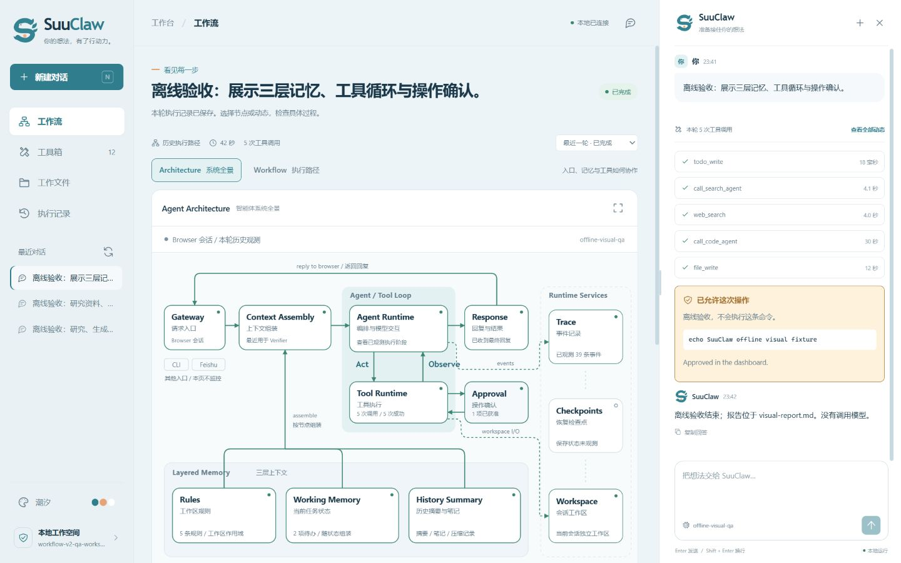
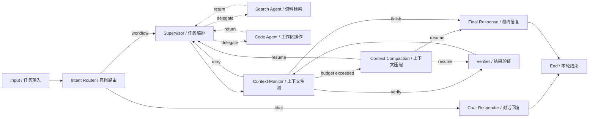

<p align="center">
  
</p>

# SuuClaw

**把任务交给 Agent，把每一步留在视野里。**

SuuClaw 是一个本地 Agent 工作台：用右侧聊天发起任务，在中间面板查看规划、委派、工具调用和验证结果。浏览器、终端和飞书入口共用同一套任务引擎。任务有明确的工作区，执行有可追踪的事件，结果经过独立验证。

SuuClaw 提供浏览器工作台、飞书机器人和隔离会话工作区。



界面验收截图使用独立的离线测试服务，没有调用模型。[展开系统全景](docs/screenshots/suuclaw-architecture.png) · [执行路径](docs/screenshots/suuclaw-workflow.png)。[深航主题](docs/screenshots/suuclaw-abyss.jpg) · [花间主题](docs/screenshots/suuclaw-bloom.jpg)

## 启动浏览器工作台

推荐使用 [uv](https://docs.astral.sh/uv/)。在项目目录中安装依赖：

```bash
uv sync
```

首次使用时，将 `.env.example` 复制为 `.env`，填入模型配置；已有 `.env` 请保留。最小配置：

```dotenv
OPENAI_API_KEY=your-api-key
OPENAI_MODEL=gpt-4o-mini
# 使用兼容接口时填写：
# OPENAI_BASE_URL=https://your-provider.example/v1
```

启动本地服务：

```bash
uv run suuclaw dashboard --workspace ./workspace
```

打开 **[http://127.0.0.1:7788](http://127.0.0.1:7788)**。也可以使用独立入口：

```bash
uv run suuclaw-dashboard --workspace ./workspace
uv run python -m suuclaw dashboard --workspace ./workspace
```

启动界面本身不会调用模型。发送任务才会运行真实 Agent；未配置模型时，任务会给出配置错误，不会生成模拟回答。可先启动查看界面，再配置模型并重启服务。

| 参数 | 默认值 | 用途 |
| --- | --- | --- |
| `--workspace` / `-w` | 当前目录 | 浏览器会话及运行数据的存储根目录。推荐显式指定。 |
| `--port` / `-p` | `7788` | 本机服务端口。 |
| `--host` | `127.0.0.1` | 仅允许回环地址，工作台用于本机访问。 |
| `--model` | 环境中的模型配置 | 为工作台选择模型。 |

## 界面与使用方式

工作台保留三个稳定区域：左侧导航与会话，中间工作面板，右侧可调整宽度的聊天栏。切换面板时仍能继续对话。

| 面板 | 内容 |
| --- | --- |
| **工作流** | Architecture 系统全景 + Workflow 执行路径；记忆快照、工具循环、真实流向与节点详情。 |
| **工具箱** | 当前引擎的可用工具与用途。 |
| **工作文件** | 当前会话文件的预览与下载。 |
| **执行记录** | 历史任务和事件记录，支持回看执行过程。 |

工作流默认展示 **Architecture / 系统全景**，解释 Browser 入口、上下文组装、Agent 与工具循环、回复，以及三层记忆和运行记录的关系。点击模块查看实际记忆快照、工具输入输出或进入工作文件。CLI 和飞书为已有入口，本页仅跟踪 Browser 发起的任务；检查点作为已有持久化能力展示，不推断未收到的保存结果。

切换 **Workflow / 执行路径** 查看节点实际经过的路线；其中 **完整拓扑** 展开上下文压缩、回退和重试分支。节点采用 Intent Router、Supervisor、Context Monitor、Verifier 等 AI 术语，下方附中文职责。实心箭头说明方向；正在执行的节点和连接持续高亮，经过的路径保留状态，快速步骤有短暂的流向提示。历史记录加载时不会播放成正在执行。

图上方显示当前阶段和实际经过的节点；点击节点可查看职责、数据流、输出与工具结果。下方的 **实时动态 / 任务计划 / 验证结果** 分别展示事件、计划条目和验收情况。图、工具调用和最终状态来自同一次真实任务；子 Agent 执行时，Supervisor 显示等待委派结果。

左下角可切换三套主题：**潮汐、深航、花间**。SuuClaw 的标志由卷曲的 S、三枚向内的爪和一颗亮色圆点组成；终端用 `///` 与 ASCII 字标延续同一个视觉概念。

一次完整的体验：

1. 新建或选择会话。
2. 在右侧输入任务，例如“创建一个 hello.py，运行它，并验证输出为 hello”。
3. 在工作流中观察规划、工作区操作和验证节点；点击节点查看执行详情。
4. 在任务计划、验证结果和聊天最终答复中核对交付内容。
5. 在工作文件中打开成果，或切换到历史运行回看事件。

浏览器任务使用独立的会话工作区，运行数据保存在指定工作区的 `.suuclaw/dashboard/` 下。新会话从空目录开始，工作文件面板会显示其实际路径；需要处理已有文件时，将文件放入该目录。不同会话有各自的文件与对话状态，同一会话的后续任务可以继续使用之前的成果。

需要确认的命令会在聊天栏显示命令内容与风险原因，只有明确允许后才会执行；超时或关闭服务会拒绝待确认命令。关闭浏览器页面不会终止正在运行的任务，重新打开后可继续查看事件。当前没有任务取消按钮，因为底层执行线程尚不能保证安全中止。

## 终端入口

```bash
uv run suuclaw "创建 hello.py 并运行" --workspace ./sandbox
uv run suuclaw "列出全部 TODO 注释的位置" -w ./sandbox
uv run suuclaw --list-tools
uv run suuclaw --version
uv run suuclaw --resume ./sandbox
```

需要全局命令时：

```bash
uv tool install --editable .
suuclaw dashboard -w ./workspace
```

也可用 `pip install -e .` 安装。`python -m suuclaw` 与 `suuclaw` 等价。只有开头的完整单词 `dashboard` 被识别为面板子命令；若任务内容恰好就是该单词，使用 `suuclaw -- dashboard`。

常用 CLI 选项：

| 选项 | 默认值 | 用途 |
| --- | --- | --- |
| `--workspace` / `-w` | `./workspace` | 本轮操作的工作区。 |
| `--model` / `-m` | `$OPENAI_MODEL` | 模型名称。 |
| `--max-attempts` | `3` | 规划到验证的最大轮数。 |
| `--max-steps` / `--max-loops` | `25` | code agent 每次委派允许的模型循环数。 |
| `--approval-mode` | `inline` | 风险命令策略：`inline` 交互确认，`auto` 自动允许，`deny` 拒绝。 |
| `--checkpoint-mode` | `light` | 检查点：`light`、`strict` 或 `off`。 |
| `--trace-mode` | `on` | 是否记录执行轨迹。 |
| `--command-timeout` | `120` 秒 | 命令执行的超时。 |
| `--retries` | `2` | 短暂模型请求失败的额外重试次数。 |
| `--show-trace` | 关闭 | 显示完整工具结果。 |
| `--quiet` / `-q` | 关闭 | 仅输出最终结果。 |

CLI 退出码：`0` 表示通过验证；`1` 表示没有满足验收条件；`2` 表示配置错误或执行中断。输出重定向时，失败报告写入 stderr，避免被当作成功成果继续处理。

### 交互式终端

```bash
uv sync --extra tui
uv run suuclaw --tui --workspace ./sandbox
```

TUI 包含 SuuClaw 动态字标、会话状态、计划、执行日志与输入框。`Enter` 提交，`Ctrl+L` 清空日志，`Ctrl+C` 退出。需要确认的风险命令在终端弹窗中处理。终端必须支持交互；流水线输出请使用普通 CLI。

## 飞书机器人

安装可选 SDK：

```bash
uv sync --extra feishu
```

在飞书开放平台创建自建应用，开启机器人能力，通过长连接订阅 `im.message.receive_v1`，并配置消息收发权限。在 `.env` 中填写：

```dotenv
FEISHU_APP_ID=cli_xxxxxxxxxxxxxxxx
FEISHU_APP_SECRET=xxxxxxxxxxxxxxxxxxxxxxxxxxxxxxxx
SUUCLAW_FEISHU_WORKSPACE=workspace
SUUCLAW_FEISHU_APPROVAL_MODE=deny
```

先校验配置，再启动：

```bash
uv run suuclaw-feishu --check
uv run suuclaw-feishu
# 等价入口：
uv run python -m suuclaw.feishu
```

默认接受私聊；群聊需要明确 @ 机器人。每个聊天 / 话题使用隔离工作区，同一会话的任务串行运行。状态面板持续展示路由、工作流阶段、工具调用、验证轮次与耗时，完成后发送完整答复。

| 设置 | 默认值 | 用途 |
| --- | --- | --- |
| `SUUCLAW_FEISHU_MAX_CONCURRENCY` | `4` | 并发会话上限。 |
| `SUUCLAW_FEISHU_MODEL` | 模型环境配置 | 飞书独立模型覆盖。 |
| `SUUCLAW_FEISHU_SESSION_ROOT` | 自动设置 | 隔离工作区与文件快照的存储位置。 |
| `SUUCLAW_FEISHU_APPROVAL_MODE` | `deny` | 无人值守时拒绝风险命令；可信主机可显式设置为 `auto`。 |
| `SUUCLAW_FEISHU_WORKFLOW_PROGRESS` | `true` | 更新工作流状态面板。 |
| `SUUCLAW_FEISHU_WORKFLOW_HEARTBEAT_SECONDS` | `60` | 长任务状态更新间隔。 |
| `SUUCLAW_FEISHU_ENTRY_TIMEOUT` | `30` 秒 | 任务路由超时后进入工具工作流。 |
| `SUUCLAW_FEISHU_DELIVER_ARTIFACTS` | `true` | 回传本轮成功写入的文件。 |
| `SUUCLAW_FEISHU_ARTIFACT_MAX_FILES` | `8` | 自动附件数量上限。 |
| `SUUCLAW_FEISHU_ARTIFACT_MAX_MB` | `25` | 单个附件大小上限。 |
| `SUUCLAW_FEISHU_REQUIRE_MENTION` | `true` | 群内需要 @ 机器人。 |
| `SUUCLAW_FEISHU_WS_PROXY` | `direct` | `auto` 时读取系统代理环境配置。 |

自动附件在上传前会复制到本轮独立快照，隐藏文件、疑似密钥、空文件及超限文件会被跳过。多文件网页另附保留目录结构的 ZIP。附件发送需要应用权限 `im:resource`，修改权限后需发布应用版本。

`/new`（或“新会话”）创建新会话和工作区；`/status`（或“会话状态”）查看当前会话。旧会话及成果会保留。

## 实现结构

SuuClaw 使用 Python、LangGraph、LangChain、Typer / Rich，以及原生 HTML / CSS / JavaScript。浏览器界面不需要 Node 构建步骤，后端使用标准库 HTTP 服务与 SSE。



- **Planner** 通过结构化 `todo_write` 发布计划，并用委派工具调度专门的 Agent。
- **Search** 提供只读网页检索；**Code** 使用文件、搜索、命令执行和工作笔记工具。
- **Verifier** 执行验收命令并检查结果；未通过时带着具体问题回到 Planner。
- **事件层** 把 `node_start`、`handoff`、`tool_call`、`tool_result`、`node_output`、`final_answer` 等统一交给界面消费。
- **浏览器服务** 保存会话与运行事件，通过 SSE 向图、计划、验证面板和聊天栏推送同一轮状态。
- **终端与飞书** 复用现有任务引擎，分别将事件渲染为终端日志和中文状态面板。

目录职责：

```text
src/suuclaw/
  dashboard/     浏览器服务、会话运行管理、静态界面与主题
  cli/           普通 CLI 与可选 Textual TUI
  feishu/        飞书配置、长连接、会话隔离与附件
  core/          会话、状态、事件、路径约束、检查点与轨迹
  graph/         路由、规划、验证和工作流拓扑
  agents/        检索与实现等专门 Agent
  tools/         文件、搜索、命令及工作笔记工具
  providers/     模型配置与 OpenAI 兼容接口
```

## 配置

`.env` 从项目根目录加载，已有进程环境变量优先。模型相关配置包括 `OPENAI_API_KEY`、`OPENAI_MODEL`、`OPENAI_BASE_URL`、`OPENAI_TIMEOUT` 和 `OPENAI_MAX_RETRIES`。网页检索需要 `TAVILY_API_KEY` 与 `uv sync --extra search`。

命令与 Python 包统一使用 `suuclaw`。飞书设置使用 `SUUCLAW_FEISHU_*`，Shell 与上下文预算分别使用 `SUUCLAW_SHELL` 和 `SUUCLAW_CONTEXT_TOKEN_LIMIT`。运行数据保存在 `.suuclaw/`，浏览器数据保存在 `.suuclaw/dashboard/`。本版本不再读取旧品牌的环境变量或运行目录；升级时请使用当前配置名称，并重启 CLI、浏览器服务和飞书网关。

文件类工具会验证路径必须在工作区内。`bash` 是本机命令执行，工作区路径检查不等于操作系统沙箱；远程消息默认采用 `deny`，需要更强隔离时请在容器或虚拟机中运行。

## 开发验证

```bash
uv run pytest
uv run ruff check src tests
```

测试使用伪模型或注入的事件流验证路由、会话隔离、附件与界面服务。它们不会自动调用付费模型。浏览器空状态可直接查看；真实端到端任务需要有效的模型配置。
